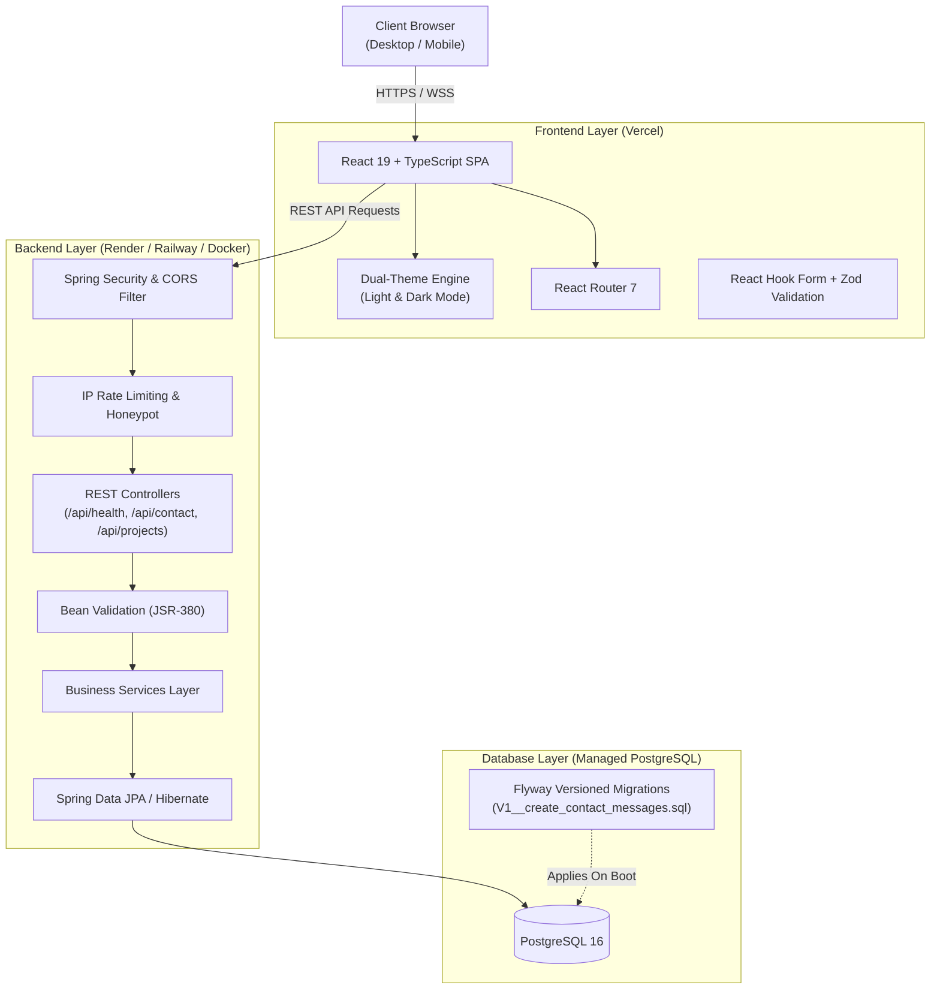

# Arun Pandian — Full-Stack Software Engineer Portfolio

> **Building reliable software, from interface to infrastructure.**  
> Full-stack portfolio application showcasing production-grade engineering using React, TypeScript, Java 21, Spring Boot, REST APIs, and PostgreSQL.

[](https://arunpandian.online)
[](https://github.com/arun-pandian-p/arunpandian.online)
[](https://github.com/arun-pandian-p/arunpandian.online)
[](LICENSE)

---

## 1. Professional Profile

- **Name:** Arun Pandian
- **Title:** Full-Stack Software Engineer
- **Education:** B.Tech Artificial Intelligence & Data Science (Class of 2026)
- **Location:** Coimbatore, Tamil Nadu, India
- **Availability:** Open to fresher Software Development Engineer (SDE) roles and engineering internships.
- **Portfolio:** [https://arunpandian.online](https://arunpandian.online)
- **GitHub:** [https://github.com/arun-pandian-p](https://github.com/arun-pandian-p)
- **LinkedIn:** [https://linkedin.com/in/arunpandian-developer/](https://linkedin.com/in/arunpandian-developer/)

---

## 2. System Architecture



---

## 3. Technology Stack

### Frontend
- **Framework & Runtime:** React 19, TypeScript 5.7, Vite 6
- **Routing:** React Router 7
- **Styling:** Tailwind CSS 3 / 4 design tokens with full dual-theme CSS variables
- **Animations:** Framer Motion (respects `prefers-reduced-motion`)
- **Icons:** Lucide React
- **Forms & Validation:** React Hook Form + Zod

### Backend
- **Language & Runtime:** Java 21 LTS
- **Framework:** Spring Boot 3.3.4
- **Web & Routing:** Spring Web (REST API architecture)
- **Data Persistence:** Spring Data JPA, Hibernate ORM
- **Security:** Spring Security (stateless REST policies, strict CORS, security headers)
- **Validation:** Bean Validation (`jakarta.validation`)
- **Database Migrations:** Flyway Migrations
- **Build & Dependency Tool:** Apache Maven 3.9

### Database & Deployment
- **Database:** PostgreSQL 16 (or Supabase / Neon / Render PostgreSQL)
- **Frontend Hosting:** Vercel (configured with `vercel.json` SPA routing & security headers)
- **Backend Hosting:** Render / Railway / Docker container
- **Containerization:** Multi-stage `Dockerfile` + `docker-compose.yml`

---

## 4. Key Engineering Features

1. **Dual-Theme Design System:**
   - Inspired by Linear, Vercel, and Stripe.
   - Polished **Light Theme** (crisp whites, slate borders, refined shadows) and **Dark Theme** (deep navy, elevated surfaces, restrained depth).
   - Zero-FOUC (Flash of Unstyled Content) initialization script in `<head>`.
   - Respects operating system `prefers-color-scheme` on first visit and persists manual choices in `localStorage`.

2. **Clean Developer Portfolio (No CMS Overhead):**
   - Removed legacy CMS, newsletters, scraping services, and admin logins.
   - Clean, version-controlled TypeScript data records.
   - Fast, resilient, and maintainable.

3. **Secure REST API & Contact Workflow:**
   - Client-side validation with React Hook Form and Zod.
   - Server-side validation with `@Valid` and Bean Validation annotations.
   - Silent honeypot detection for spam prevention without disrupting legitimate visitors.
   - In-memory/database IP rate limiting (maximum 5 submissions per 10-minute window).
   - Standardized error response contract (`ErrorResponse`).

4. **SEO, Performance & Accessibility:**
   - Semantic HTML5 structure.
   - JSON-LD Structured Data for `Person` and `WebSite`.
   - Open Graph and Twitter Cards metadata.
   - `sitemap.xml` and `robots.txt` in `frontend/public`.
   - Code splitting with manual Rollup chunking (`react-vendor`, `motion-vendor`, `ui-vendor`).

---

## 5. Repository Structure

```text
portfolio/
├── frontend/
│   ├── public/
│   │   ├── favicon.svg
│   │   ├── resume.pdf
│   │   ├── robots.txt
│   │   └── sitemap.xml
│   ├── src/
│   │   ├── app/
│   │   │   ├── App.tsx
│   │   │   └── router.tsx
│   │   ├── components/
│   │   │   ├── layout/
│   │   │   │   ├── Navbar.tsx
│   │   │   │   ├── Footer.tsx
│   │   │   │   └── PageTransition.tsx
│   │   │   └── ui/
│   │   │       ├── Button.tsx
│   │   │       ├── SectionHeading.tsx
│   │   │       ├── ProjectCard.tsx
│   │   │       ├── SkillBadge.tsx
│   │   │       ├── SocialLinks.tsx
│   │   │       └── ThemeToggle.tsx
│   │   ├── data/
│   │   │   ├── navigation.ts
│   │   │   ├── projects.ts
│   │   │   ├── experience.ts
│   │   │   └── skills.ts
│   │   ├── features/
│   │   │   ├── home/HomePage.tsx
│   │   │   ├── about/AboutPage.tsx
│   │   │   ├── projects/
│   │   │   │   ├── ProjectsPage.tsx
│   │   │   │   └── ProjectDetailPage.tsx
│   │   │   ├── experience/ExperiencePage.tsx
│   │   │   ├── skills/SkillsPage.tsx
│   │   │   ├── contact/ContactPage.tsx
│   │   │   └── resume/ResumePage.tsx
│   │   ├── hooks/useTheme.ts
│   │   ├── lib/
│   │   │   ├── api.ts
│   │   │   └── validation.ts
│   │   ├── styles/index.css
│   │   └── types/index.ts
│   ├── index.html
│   ├── package.json
│   ├── tsconfig.json
│   ├── vercel.json
│   └── vite.config.ts
├── backend/
│   ├── src/main/java/com/arunpandian/portfolio/
│   │   ├── PortfolioApplication.java
│   │   ├── config/
│   │   │   ├── CorsConfig.java
│   │   │   └── SecurityConfig.java
│   │   ├── controller/
│   │   │   ├── ContactController.java
│   │   │   ├── HealthController.java
│   │   │   └── ProjectController.java
│   │   ├── dto/
│   │   │   ├── ContactRequest.java
│   │   │   ├── ContactResponse.java
│   │   │   └── ProjectDto.java
│   │   ├── entity/ContactMessage.java
│   │   ├── exception/
│   │   │   ├── ErrorResponse.java
│   │   │   └── GlobalExceptionHandler.java
│   │   ├── repository/ContactRepository.java
│   │   └── service/
│   │       ├── ContactService.java
│   │       └── ProjectService.java
│   ├── src/main/resources/
│   │   ├── application.yml
│   │   └── db/migration/V1__create_contact_messages.sql
│   ├── src/test/
│   │   ├── java/com/arunpandian/portfolio/
│   │   │   ├── PortfolioApplicationTests.java
│   │   │   ├── controller/ContactControllerTest.java
│   │   │   └── controller/HealthControllerTest.java
│   │   └── resources/application.yml
│   ├── Dockerfile
│   └── pom.xml
├── docker-compose.yml
├── .gitignore
├── LICENSE
└── README.md
```

---

## 6. REST API Endpoints

| Method | Endpoint | Description | Access |
|---|---|---|---|
| `GET` | `/api/health` | Backend service health, uptime, and runtime version | Public |
| `POST` | `/api/contact` | Submit inquiry form (with validation, honeypot, & rate limiting) | Public |
| `GET` | `/api/projects` | List all verified software engineering projects | Public |
| `GET` | `/api/projects/{slug}` | Retrieve deep architectural specification for a project | Public |

### Sample Contact Request Payload:
```json
{
  "name": "Alex Johnson",
  "email": "alex@company.com",
  "subject": "Full-Stack Software Engineer Opportunity",
  "message": "Hi Arun, we came across your portfolio and would like to invite you for an SDE interview."
}
```

---

## 7. Local Development Guide

### Prerequisites
- **Node.js:** v20+ (tested on Node v26)
- **Java:** JDK 21+
- **Maven:** 3.9+
- **Docker & Docker Compose** (optional, for local PostgreSQL)

### Option A: Running with Docker Compose (Recommended for Full Stack)
```bash
# Clone the repository
git clone https://github.com/arun-pandian-p/arunpandian.online.git
cd arunpandian.online

# Spin up PostgreSQL and Spring Boot backend
docker-compose up -d

# Install and start Frontend
cd frontend
npm install
npm run dev
```
The frontend will start at `http://localhost:5173`, and the Java backend will be listening at `http://localhost:8080`.

### Option B: Running Services Individually

#### 1. Backend Service
```bash
cd backend

# Run with local PostgreSQL running on port 5432
mvn spring-boot:run

# Or run tests using in-memory H2 (zero external dependencies required)
mvn test
```

#### 2. Frontend Application
```bash
cd frontend

# Install dependencies
npm install

# Start development server
npm run dev

# Run production build
npm run build
```

---

## 8. Verified Engineering Projects

1. **[Zappy — Restaurant SaaS Platform](https://github.com/arun-pandian-p/Zappy)**  
   Multi-tenant restaurant ordering platform featuring QR-code digital menus, kitchen order dispatching, role-based access control (RBAC), and PostgreSQL database architecture.
2. **Ashnora — Restaurant Management System**  
   All-in-one restaurant operational system integrating Point of Sale (POS), Kitchen Display Systems (KDS), real-time inventory tracking, and floor management.
3. **Ap Desktop — Placement Preparation Platform**  
   Offline-first desktop application built with Electron, React, TypeScript, Java, and SQLite for computer science students to practice coding patterns and DSA problem roadmaps.
4. **Technical Engineering Publishing Platform**  
   Self-hosted technical publishing engine built with Java Spring Boot and React, delivering Markdown rendering, syntax highlighting, and database-backed article management.

---

## 9. License

This project is licensed under the MIT License — see the [LICENSE](LICENSE) file for details.

