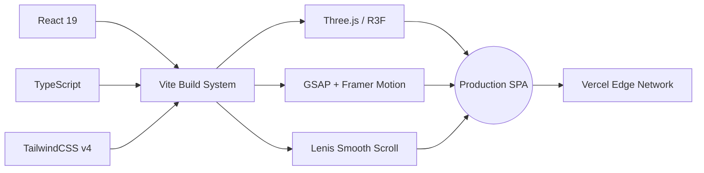

<div align="center">


<br/>

[](https://linkedin.com/in/arunpandianp-dataanalyst)
[](#)
[](#)

<br/>


<br/>

<p>
  <a href="#-key-features"><b>Features</b></a> ·
  <a href="#-tech-stack"><b>Tech Stack</b></a> ·
  <a href="#-project-architecture"><b>Architecture</b></a> ·
  <a href="#-local-development"><b>Development</b></a> ·
  <a href="#-deployment"><b>Deployment</b></a>
</p>

</div>

<br/>

> [!NOTE]
> This project has been fully migrated from its original Next.js/MERN architecture to a highly optimized, strictly typed single-page application (SPA). It features an Awwwards-style 3D interactive hero section powered by Three.js & Framer Motion, buttery-smooth scrolling courtesy of Lenis, and a centralized data architecture for effortless resume updates.

<br/>

## ✨ Key Features

<table>
<tr>
<td width="50%" valign="top">

### ⚡ Lightning Fast
Powered by Vite & React 19 for instantaneous HMR and highly optimized production builds.

### 🧊 Immersive 3D
Custom Three.js scenes rendered declaratively via `@react-three/fiber` and `@react-three/drei`, no imperative WebGL boilerplate.

</td>
<td width="50%" valign="top">

### 🎨 Awwwards-Style UI
Fluid GSAP & Framer Motion animations, parallax scrolling, and a dark/light minimalist aesthetic.

### 🧩 Centralized Content
A strict data model (`resumeData.ts`) drives the entire site — update once, reflect everywhere.

</td>
</tr>
</table>

<div align="center">

| Capability | Description |
|:--|:--|
| 🖱️ **Smooth Scroll** | Lenis-powered inertia scrolling for a native app-like feel |
| 🌗 **Theme Aware** | Dark/light mode with zero flash-of-unstyled-content |
| 📱 **Fully Responsive** | Fluid layouts from mobile to ultrawide |
| 🔒 **Strictly Typed** | End-to-end TypeScript contracts across components |
| 🚀 **Edge Deployed** | Zero-config Vercel deployment with automatic previews |

</div>

<br/>

## 🛠️ Tech Stack

<div align="center">



</div>

<br/>

## 📂 Project Architecture

<details open>
<summary><b>Click to expand / collapse directory tree</b></summary>

```text
/
├── public/                 # Static assets (favicons, PDFs, legacy media)
│   ├── legacy/              # Archived media files from prior builds
│   └── resume.pdf           # Linked résumé file
│
├── src/
│   ├── App.tsx              # Root router and global Lenis scroll wrapper
│   ├── main.tsx              # React DOM rendering entry point
│   │
│   ├── assets/               # Bundled media files (images, vectors)
│   │
│   ├── components/           # Modular UI Architecture
│   │   ├── common/             # Global utilities (e.g., Welcome intro screen)
│   │   ├── layout/              # Structural wrappers (Navbar)
│   │   ├── sections/            # Core page segments (Hero, About, Contact)
│   │   └── ui/                   # Reusable interactive micro-components
│   │
│   ├── data/                  # Centralized content store
│   │   └── resumeData.ts        # ALL portfolio text, links, and experience data
│   │
│   ├── pages/                 # Route views
│   │   └── HomePage.tsx          # Assembles the section components
│   │
│   ├── styles/                # Global CSS and Tailwind tokens
│   │
│   └── types/                 # TypeScript interface contracts
│
├── vite.config.ts           # Vite build and plugin configuration
└── package.json              # Dependencies and npm scripts
```

</details>

<br/>

## 🧠 Data Management & Customization

The site operates as a statically built portfolio — no external CMS or database required.

**To update content, edit a single typed object:**

```ts
// src/data/resumeData.ts
export const resumeData = {
  personalInfo: { ... },
  skills: { ... },
  experience: [ ... ],
  projects: [ ... ]
}
```

All UI components strictly adhere to the interfaces in **`src/types/index.ts`** and instantly reflect changes from this single source of truth — no hunting through JSX to update your résumé.

<br/>

## 💻 Local Development

<details open>
<summary><b>Get started in 3 steps</b></summary>

<br/>

**1. Install dependencies**
```bash
npm install
```

**2. Start the development server**
```bash
npm run dev
```
> Site available at `http://localhost:5173` with instant HMR.

**3. Build for production**
```bash
npm run build
```

</details>

<br/>

## 🌍 Deployment

<div align="center">

[](#)

</div>

This project is configured out-of-the-box for **Vercel**, with the `vercel` CLI tracked as a dependency.

1. Link Vercel to the repository.
2. Push to `main` — Vercel auto-detects Vite and serves the `dist/` folder via its standard Node.js pipeline.
3. Every PR gets an automatic preview deployment.

<br/>

## 🗺️ Roadmap

- [x] Migrate from Next.js/MERN to Vite SPA
- [x] Integrate Three.js hero scene
- [x] Centralize resume data model
- [ ] Add CMS-lite (JSON-driven) content editing
- [ ] Add case-study detail pages per project
- [ ] Lighthouse 100/100 across all categories

<br/>

<div align="center">

### 📬 Let's Connect

[](https://linkedin.com/in/arunpandianp-dataanalyst)

<br/>


<sub>Built with ❤️ by <a href="https://linkedin.com/in/arunpandianp-dataanalyst"><b>Arun Pandian</b></a></sub>

</div>
